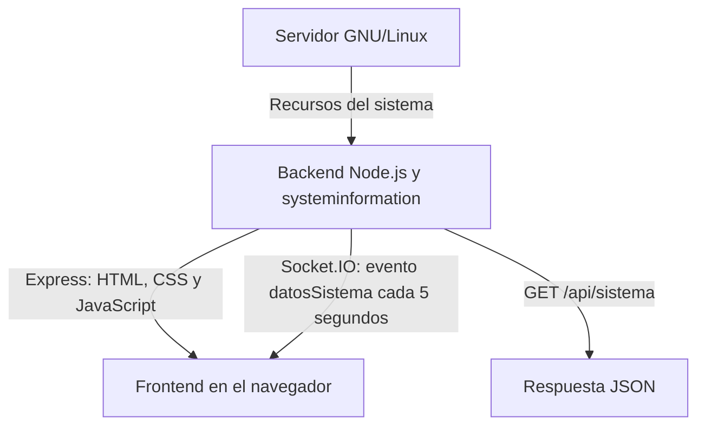

# Monitor de recursos GNU/Linux

Trabajo Final Integrador de Práctica Profesionalizante III.

Aplicación web para consultar los recursos de un servidor GNU/Linux.
El backend obtiene la información del sistema y la envía al frontend
mediante Socket.IO. También ofrece una API HTTP para consultar los datos
en formato JSON.

## Funcionalidades

- Consultar fabricante, modelo y núcleos del procesador.
- Mostrar la temperatura del procesador cuando esté disponible.
- Consultar memoria RAM total, disponible y utilizada.
- Mostrar información de la partición raíz y de la memoria swap.
- Consultar interfaces de red, direcciones IP y tráfico acumulado.
- Recibir actualizaciones automáticas cada cinco segundos.
- Mostrar los recursos por separado o en un resumen general.
- Iniciar el backend automáticamente mediante systemd.

## Tecnologías utilizadas

### Frontend

- HTML.
- CSS.
- JavaScript.
- Bootstrap 5.
- Cliente de Socket.IO.
- Bootstrap Icons para los iconos de la interfaz.

Bootstrap Icons es un complemento incorporado al diseño, adicional al
ejemplo base del material.

### Backend

- Node.js.
- pnpm.
- Express.
- HTTP.
- Socket.IO.
- CORS.
- systeminformation.

### Control de versiones

- Git y GitHub.
- Ramas `mateo1` y `mateo2`.
- Rama `main` para integrar los avances.
- Markdown y Mermaid para la documentación.

## Estructura del repositorio

```text
PPIII-Monitoreo/
├── README.md
└── monitor-sistema/
    ├── .gitignore
    ├── backend/
    │   ├── package.json
    │   ├── pnpm-lock.yaml
    │   └── server.js
    ├── deploy/
    │   └── monitor-sistema.service
    └── frontend/
        └── public/
            ├── index.html
            ├── index.js
            └── style.css
```

La carpeta `node_modules` no se incorpora al repositorio. Las dependencias
se instalan con pnpm a partir de los archivos del backend.

## Funcionamiento



El backend y el frontend están separados en carpetas, pero se sirven
desde la misma aplicación.

Express entrega los archivos de `frontend/public`. El navegador ejecuta
`index.js`, se conecta mediante Socket.IO y actualiza la sección elegida.

## Requisitos

- Servidor GNU/Linux.
- Node.js 24.
- pnpm.
- Navegador web.
- Conectividad entre el equipo cliente y el servidor.

El frontend carga Bootstrap, Bootstrap Icons y el cliente de Socket.IO
desde servicios CDN. Por este motivo, el navegador necesita acceso a
Internet para descargar esos recursos.

## Instalación y ejecución manual

Desde la raíz del repositorio:

```bash
cd monitor-sistema/backend
pnpm install
pnpm start
```

Abrir en el navegador:

```text
http://IP_DEL_SERVIDOR:3000/
```

Reemplazar `IP_DEL_SERVIDOR` por la dirección actual de Debian.

Para consultar la IP en Debian:

```bash
ip -4 -br address
```

Para detener una ejecución manual, presionar `Ctrl + C`.

Si el servicio systemd ya está ejecutando el backend, no iniciar otra
instancia con `pnpm start` en el mismo puerto.

## API HTTP

### GET /api/sistema

Devuelve un objeto JSON con:

- `timestamp`: fecha y hora de la consulta.
- `cpu`: información del procesador.
- `memoria`: información de la memoria RAM.
- `particiones`: información de raíz y swap.
- `red`: información de las interfaces de red.

Dirección de consulta:

```text
http://IP_DEL_SERVIDOR:3000/api/sistema
```

## Actualizaciones con Socket.IO

El servidor emite el evento `datosSistema` cada cinco segundos
para cada cliente conectado.

El frontend utiliza:

```javascript
const socket = io();
```

Esto permite conectarse al mismo servidor y puerto desde donde se
abrió la página, sin escribir una IP fija dentro del JavaScript.

Si cambia la IP de Debian, es necesario abrir la dirección nueva
en el navegador. El código del frontend no necesita modificarse.

El backend escucha en `0.0.0.0`, lo que permite recibir conexiones
por las interfaces de red del servidor. Esta configuración no fija
la IP de Debian ni permite descubrir automáticamente una IP nueva.

## Inicio automático con systemd

La instalación utilizada en Debian se encuentra en:

```text
/var/www/html/monitor-sistema/
```

El archivo `deploy/monitor-sistema.service` contiene la configuración
del servicio y utiliza esa ruta y el ejecutable `/usr/bin/node`.

Con el proyecto y sus dependencias instalados en esa ubicación,
ejecutar como root:

```bash
cp /var/www/html/monitor-sistema/deploy/monitor-sistema.service /etc/systemd/system/
systemctl daemon-reload
systemctl enable --now monitor-sistema
```

Consultar el estado:

```bash
systemctl status monitor-sistema --no-pager -l
```

Comprobar la habilitación y la ejecución:

```bash
systemctl is-enabled monitor-sistema
systemctl is-active monitor-sistema
```

Después de modificar el backend:

```bash
systemctl restart monitor-sistema
```

## Trabajo con ramas

- `main`: contiene los avances integrados.
- `mateo1`: rama de trabajo del primer integrante.
- `mateo2`: rama de trabajo del segundo integrante.

Cada integrante trabaja en su propia rama. Los avances se guardan
mediante commits y se publican con `git push`. Cuando corresponde,
se integran en `main` mediante merge.

Cambiar de rama no cambia el nombre ni el correo del autor de los commits.

Subir cambios a GitHub no actualiza automáticamente la instalación
de Debian. Los archivos modificados deben trasladarse al servidor.

## Base del material y adaptaciones

Se tomó como base la guía de armado del backend y los ejemplos
de monitoreo proporcionados por el profesor.

Adaptaciones realizadas:

- Separación en carpetas `backend` y `frontend`.
- Publicación de `frontend/public` mediante Express.
- Conexión del cliente con `io()` para evitar una IP fija en el código.
- Diseño con Bootstrap 5, menú y tarjetas.
- Navegación para mostrar una sección por vez.
- Incorporación de Bootstrap Icons.
- Configuración de inicio automático mediante systemd.

## Limitaciones conocidas

- La temperatura puede aparecer como `N/D` cuando no está disponible.
- El ejemplo base identifica la raíz como `sda1` dentro del JSON,
  aunque el dispositivo real puede tener otro nombre.
- El ejemplo base fija `/dev/sda5` como nombre de swap y utiliza un
  tamaño de 975 MiB si no detecta swap. Ese valor de respaldo no
  representa necesariamente la configuración real del servidor.
- La interfaz muestra información del procesador, pero todavía no
  muestra su porcentaje de utilización.
- La aplicación utiliza HTTP y no incorpora autenticación.

## Verificaciones realizadas

- Consulta de la API desde el navegador.
- Inicio automático del servicio después de reiniciar Debian.
- Acceso al frontend servido por Express.
- Conexión de Socket.IO y recepción de datos en el panel.

## Pendientes de la entrega

- Configurar GitHub Projects y registrar las tareas en el tablero Kanban.
- Revisar los apartados Charts y GitHub Helpers con su material específico.
- Preparar y comprobar la versión móvil solicitada en el TP.
- Completar las pruebas de todas las secciones y la documentación final.