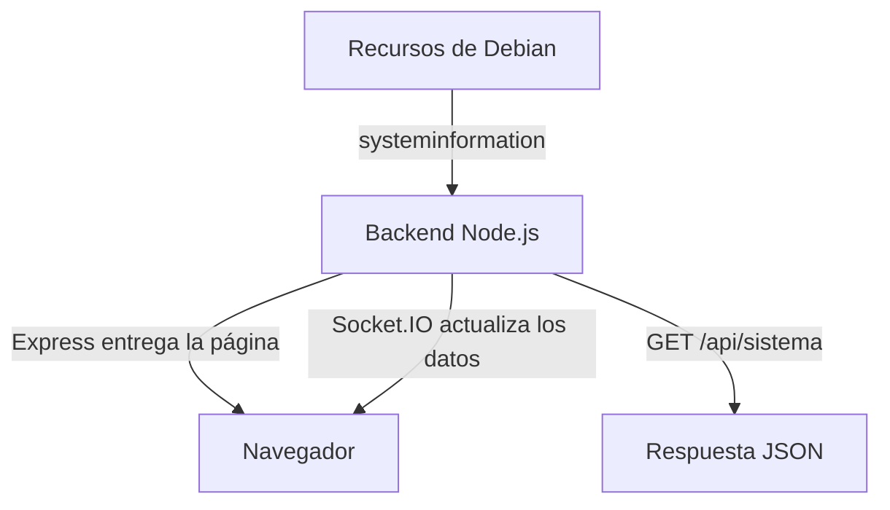

# Monitor de recursos GNU/Linux

Trabajo Final Integrador de Práctica Profesionalizante III.

Desarrollamos una aplicación web para consultar los recursos de un servidor
Debian desde una computadora o un celular. Partimos del ejemplo del profesor
y adaptamos el diseño para organizar la información por secciones.

## ¿Qué muestra?

- Procesador: fabricante, modelo, núcleos y temperatura, cuando está disponible.
- Memoria RAM: total, disponible y utilizada.
- Almacenamiento: espacio de la partición raíz y uso de swap.
- Red: interfaces, direcciones IP, MAC y datos recibidos y enviados.

Los datos se actualizan automáticamente cada cinco segundos mediante
Socket.IO. El menú permite ver una sección por vez o un resumen general.

## Tecnologías utilizadas

En el frontend usamos HTML, CSS, JavaScript y Bootstrap 5.
También incorporamos Bootstrap Icons para los iconos.

En el backend usamos Node.js, Express, HTTP, Socket.IO, CORS y
systeminformation. Las dependencias se administran con pnpm.

Para organizar el trabajo usamos Git, GitHub y un tablero Kanban.
La documentación está escrita en Markdown e incluye un diagrama Mermaid.

## Organización del proyecto

| Carpeta o archivo | Contenido |
| --- | --- |
| `monitor-sistema/backend/` | Servidor, API y dependencias. |
| `monitor-sistema/frontend/public/` | HTML, CSS y JavaScript del panel. |
| `monitor-sistema/deploy/` | Configuración del servicio systemd. |
| `docs/` | Documentación complementaria y evidencias. |
| `README.md` | Presentación e instrucciones del proyecto. |

El archivo `.gitignore` evita subir las dependencias de `node_modules`.

## ¿Cómo funciona?

El backend consulta los recursos de Debian con systeminformation.
Express entrega la página al navegador y Socket.IO envía los datos
para actualizar el panel sin recargarlo.

También se pueden consultar los datos directamente en formato JSON
mediante la ruta `/api/sistema`.



## Instalación y uso

Se necesita un servidor GNU/Linux con Node.js 24 y pnpm.
El equipo desde el que se abre el panel debe tener conexión con el servidor.

Desde la raíz del repositorio:

```bash
cd monitor-sistema/backend
pnpm install
pnpm start
```

Para abrir el panel:

```text
http://IP_DEL_SERVIDOR:3000/
```

Para consultar la API:

```text
http://IP_DEL_SERVIDOR:3000/api/sistema
```

La IP de Debian se puede consultar con:

```bash
ip -4 -br address
```

El frontend utiliza `io()` para conectarse al servidor desde el que se
abrió la página. Si cambia la IP de Debian, hay que cambiar la dirección
en el navegador, pero no el código del frontend.

El backend escucha en `0.0.0.0`, por lo que acepta conexiones por las
interfaces de red del servidor.

Para detener la ejecución manual se utiliza `Ctrl + C`.
Si el servicio systemd ya está funcionando, no se debe iniciar otra
instancia en el mismo puerto.

El navegador necesita acceso a Internet para cargar Bootstrap,
Bootstrap Icons y el cliente de Socket.IO desde sus servicios CDN.

## Inicio automático en Debian

En nuestra instalación, el proyecto está ubicado en:

```text
/var/www/html/monitor-sistema/
```

El archivo `deploy/monitor-sistema.service` permite iniciar el backend
automáticamente al encender Debian. Utiliza esa ubicación y el ejecutable
`/usr/bin/node`.

Con el proyecto y sus dependencias instalados, ejecutar como root:

```bash
cp /var/www/html/monitor-sistema/deploy/monitor-sistema.service /etc/systemd/system/
systemctl daemon-reload
systemctl enable --now monitor-sistema
```

Para consultar su estado:

```bash
systemctl status monitor-sistema --no-pager -l
```

Después de modificar el backend:

```bash
systemctl restart monitor-sistema
```

## Trabajo en equipo

Cada integrante trabaja en su rama: `mateo1` o `mateo2`.
Los avances se guardan con commits, se suben a GitHub y se integran
en `main` mediante merge cuando están revisados.

Subir un cambio a GitHub no actualiza la instalación de Debian.
Los archivos modificados también deben trasladarse al servidor.

Organizamos las tareas pendientes, en progreso y terminadas en el
[tablero Kanban](https://github.com/users/casemmateo/projects/1).

El tablero es privado y ambos integrantes tienen acceso.
Queda pendiente garantizar el acceso del docente para la entrega.

## GitHub Helpers

Utilizamos dos herramientas web del material de clase:

- **GitHub1s:** para explorar el código y consultar el README desde el navegador.
- **GitDiagram:** para generar un diagrama del repositorio y revisar sus componentes.

La explicación y las capturas están en
[Uso de GitHub Helpers](docs/github-helpers.md).

## Adaptaciones al material

Tomamos como base la guía y el ejemplo de monitoreo del profesor.
Separamos backend y frontend en carpetas, publicamos el panel con Express
y adaptamos el diseño con Bootstrap, navegación por secciones e iconos.
Bootstrap Icons fue un complemento agregado al ejemplo.

Durante las pruebas también corregimos las unidades a GiB y MiB,
el espacio disponible del disco y los datos de swap. Eliminamos el
tamaño de respaldo que mostraba el ejemplo cuando no había swap.

Estas correcciones son adaptaciones nuestras y mantienen las mismas
dependencias del backend. Para comprobar el campo de espacio disponible
consultamos la
[documentación de systeminformation](https://systeminformation.io/filesystem.html).

## Pruebas realizadas y detalles a tener en cuenta

Probamos la API, la navegación entre secciones y las actualizaciones
automáticas. Comparamos datos con los comandos de Debian y comprobamos
el inicio del servicio después de reiniciar la máquina virtual.

También probamos el panel desde el navegador de un celular conectado
a la misma red. La instalación de la APK todavía no fue probada.

Al interpretar los datos:

- La temperatura puede aparecer como `N/D` si no está disponible.
- La RAM y el almacenamiento se muestran en GiB; el tráfico de red, en MiB.
- Los datos de red son cantidades acumuladas, no velocidades.
- El espacio disponible del disco puede diferir del total menos lo usado.
- Las claves `sda1` y `sda5` se conservaron del ejemplo en el JSON.
  La raíz se busca por su montaje `/` y la swap representa el total del sistema.
- El panel muestra información del procesador, pero no su porcentaje de uso.
- La aplicación funciona mediante HTTP y no incluye autenticación.

## Pendientes

- Revisar el apartado Charts con el material correspondiente.
- Completar responsables y evidencias del tablero.
- Garantizar el acceso del docente al tablero.
- Crear y probar la APK como última etapa.
- Realizar la revisión final de la entrega.