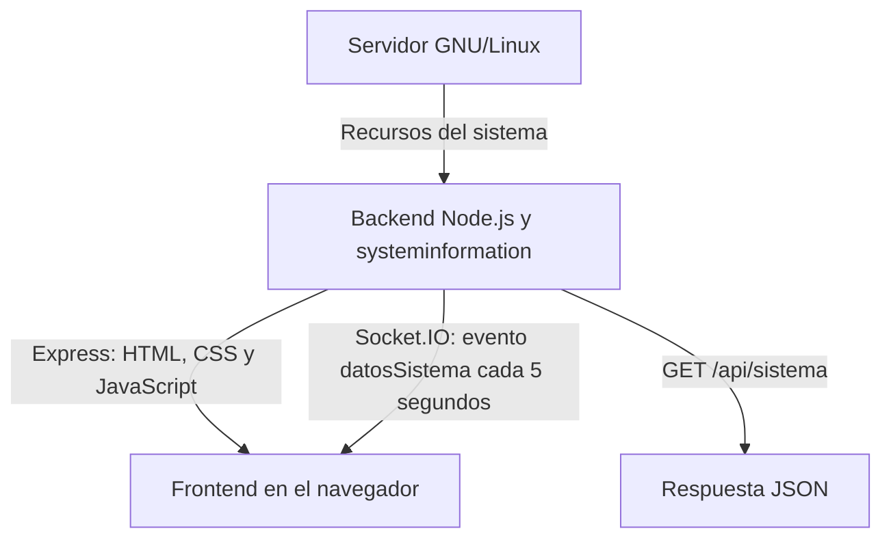

# Monitor de recursos GNU/Linux

Trabajo Final Integrador de Práctica Profesionalizante III.

Aplicación web para consultar los recursos de un servidor GNU/Linux.
El backend obtiene la información del sistema y la envía al frontend
mediante Socket.IO. También ofrece una API HTTP para consultar los datos
en formato JSON.

## Funcionalidades

- Consultar fabricante, modelo y núcleos del procesador.
- Mostrar la temperatura del procesador cuando esté disponible.
- Consultar memoria RAM total, disponible y utilizada.
- Mostrar información de la partición raíz y de la memoria swap.
- Consultar interfaces de red, direcciones IP y tráfico acumulado.
- Recibir actualizaciones automáticas cada cinco segundos.
- Mostrar los recursos por separado o en un resumen general.
- Acceder desde el navegador de una computadora o un celular.
- Iniciar el backend automáticamente mediante systemd.

## Tecnologías utilizadas

### Frontend

- HTML.
- CSS.
- JavaScript.
- Bootstrap 5.
- Cliente de Socket.IO.
- Bootstrap Icons para los iconos de la interfaz.

Bootstrap Icons es un complemento incorporado al diseño, adicional al
ejemplo base del material.

### Backend

- Node.js.
- pnpm.
- Express.
- HTTP.
- Socket.IO.
- CORS.
- systeminformation.

### Control de versiones

- Git y GitHub.
- Ramas `mateo1` y `mateo2`.
- Rama `main` para integrar los avances.
- Markdown y Mermaid para la documentación.
- GitHub Projects para organizar y seguir las tareas.

## Estructura del repositorio

| Ruta | Contenido |
| --- | --- |
| `README.md` | Documentación del proyecto. |
| `monitor-sistema/.gitignore` | Archivos y carpetas excluidos de Git. |
| `monitor-sistema/backend/package.json` | Dependencias y comandos del backend. |
| `monitor-sistema/backend/pnpm-lock.yaml` | Registro de versiones de las dependencias. |
| `monitor-sistema/backend/server.js` | Servidor HTTP, API y comunicación con Socket.IO. |
| `monitor-sistema/deploy/monitor-sistema.service` | Configuración del servicio systemd. |
| `monitor-sistema/frontend/public/index.html` | Estructura del panel. |
| `monitor-sistema/frontend/public/index.js` | Navegación y actualización de los datos. |
| `monitor-sistema/frontend/public/style.css` | Estilos del panel. |

La carpeta `node_modules` no se incorpora al repositorio. Las dependencias
se instalan con pnpm a partir de los archivos del backend.

## Funcionamiento



El backend y el frontend están separados en carpetas, pero se sirven
desde la misma aplicación.

Express entrega los archivos de `frontend/public`. El navegador ejecuta
`index.js`, se conecta mediante Socket.IO y actualiza la sección elegida.

## Requisitos

- Servidor GNU/Linux.
- Node.js 24.
- pnpm.
- Navegador web.
- Conectividad entre el equipo cliente y el servidor.

El frontend carga Bootstrap, Bootstrap Icons y el cliente de Socket.IO
desde servicios CDN. Por este motivo, el navegador necesita acceso a
Internet para descargar esos recursos.

## Instalación y ejecución manual

Desde la raíz del repositorio:

```bash
cd monitor-sistema/backend
pnpm install
pnpm start
```

Abrir en el navegador:

```text
http://IP_DEL_SERVIDOR:3000/
```

Reemplazar `IP_DEL_SERVIDOR` por la dirección actual de Debian.

Para consultar la IP en Debian:

```bash
ip -4 -br address
```

Para detener una ejecución manual, presionar `Ctrl + C`.

Si el servicio systemd ya está ejecutando el backend, no iniciar otra
instancia con `pnpm start` en el mismo puerto.

## API HTTP

### GET /api/sistema

Devuelve un objeto JSON con:

- `timestamp`: fecha y hora de la consulta.
- `cpu`: información del procesador.
- `memoria`: información de la memoria RAM.
- `particiones`: información de raíz y swap.
- `red`: información de las interfaces de red.

Dirección de consulta:

```text
http://IP_DEL_SERVIDOR:3000/api/sistema
```

### Interpretación de los datos

| Dato | Interpretación |
| --- | --- |
| Memoria y almacenamiento | Se expresan en GiB, dividiendo los bytes por `1024 ** 3`. |
| Tráfico de red | Se expresa en MiB, dividiendo los bytes por `1024 * 1024`. |
| RAM disponible | Se obtiene de `memoria.available` y se muestra como «Disponible». |
| RAM utilizada | Se calcula como memoria total menos memoria disponible. |
| Disco disponible | Se obtiene del campo `available` de `si.fsSize()`. |
| Swap | Se obtiene del tamaño total y el uso real informados por `si.mem()`. |
| Red recibida y enviada | Son cantidades acumuladas, no velocidades de transferencia. |

Se conservan las claves `sda1` y `sda5` del ejemplo base dentro de
`particiones`, pero no se utilizan para detectar los dispositivos.

La raíz se busca por su punto de montaje `/`. Su dispositivo real se
informa en `particiones.sda1.filesystem`.

La clave `sda5` contiene los datos totales de swap del sistema.
No indica que exista una partición llamada `/dev/sda5`.
Si no hay swap habilitada, su valor es `null` y el panel informa esa situación.

Por compatibilidad con la estructura del ejemplo, la clave `libre` se
conserva en memoria y raíz, aunque el panel muestra la etiqueta
«Disponible» para esos datos.

Los campos de tráfico de red se llaman `recibidoMiB` y `enviadoMiB`.

Los valores se muestran con dos decimales. Pueden existir pequeñas
diferencias al sumar cifras redondeadas o comparar mediciones tomadas
en distintos momentos.

En el disco, el tamaño total menos el espacio usado puede diferir del
espacio disponible, por ejemplo, por bloques reservados del sistema
de archivos.

## Actualizaciones con Socket.IO

El servidor emite el evento `datosSistema` cada cinco segundos
para cada cliente conectado.

El frontend utiliza:

```javascript
const socket = io();
```

Esto permite conectarse al mismo servidor y puerto desde donde se
abrió la página, sin escribir una IP fija dentro del JavaScript.

Si cambia la IP de Debian, es necesario abrir la dirección nueva
en el navegador. El código del frontend no necesita modificarse.

El backend escucha en `0.0.0.0`, lo que permite recibir conexiones
por las interfaces de red del servidor. Esta configuración no fija
la IP de Debian ni permite descubrir automáticamente una IP nueva.

## Inicio automático con systemd

La instalación utilizada en Debian se encuentra en:

```text
/var/www/html/monitor-sistema/
```

El archivo `deploy/monitor-sistema.service` contiene la configuración
del servicio y utiliza esa ruta y el ejecutable `/usr/bin/node`.

Con el proyecto y sus dependencias instalados en esa ubicación,
ejecutar como root:

```bash
cp /var/www/html/monitor-sistema/deploy/monitor-sistema.service /etc/systemd/system/
systemctl daemon-reload
systemctl enable --now monitor-sistema
```

Consultar el estado:

```bash
systemctl status monitor-sistema --no-pager -l
```

Comprobar la habilitación y la ejecución:

```bash
systemctl is-enabled monitor-sistema
systemctl is-active monitor-sistema
```

Después de modificar el backend:

```bash
systemctl restart monitor-sistema
```

Si se actualiza el JavaScript del frontend, recargar el navegador para
que utilice la versión nueva. En Windows se puede usar `Ctrl + F5`.

## Trabajo con ramas

- `main`: contiene los avances integrados.
- `mateo1`: rama de trabajo del primer integrante.
- `mateo2`: rama de trabajo del segundo integrante.

Cada integrante trabaja en su propia rama. Los avances se guardan
mediante commits y se publican con `git push`. Cuando corresponde,
se integran en `main` mediante merge.

Cambiar de rama no cambia el nombre ni el correo del autor de los commits.

Subir cambios a GitHub no actualiza automáticamente la instalación
de Debian. Los archivos modificados deben trasladarse al servidor.

Cuando un cambio modifica los datos que envía el backend y los que
lee el frontend, ambos archivos deben actualizarse juntos.

## Organización de tareas con GitHub Projects

El seguimiento del trabajo se realiza en el siguiente tablero:

[Planificación del monitor GNU/Linux](https://github.com/users/casemmateo/projects/1)

El tablero utiliza las siguientes columnas:

- **Pendientes (Backlog):** tareas que todavía no se iniciaron.
- **Listo (Ready):** tareas preparadas para comenzar.
- **En progreso (In progress):** tareas que se están realizando.
- **En revisión (In review):** tareas pendientes de comprobar.
- **Hecho (Done):** tareas terminadas.

Las tareas se registran como incidencias del repositorio. Cada una
incluye una descripción y una lista de comprobación. Los responsables
se asignan según el trabajo de cada integrante.

El tablero incluye registros del backend, el frontend y la documentación
realizados antes de su creación, con referencias a sus commits.
También incluye las pruebas y la preparación de la aplicación móvil.

El tablero es privado. Ambos integrantes tienen acceso; para que otras
personas puedan consultarlo será necesario otorgarles acceso o cambiar
su visibilidad antes de la entrega.

Los cambios del tablero se guardan en GitHub. Los cambios en los archivos
del proyecto se guardan mediante commits en las ramas correspondientes.

## Base del material y adaptaciones

Se tomó como base la guía de armado del backend y los ejemplos
de monitoreo proporcionados por el profesor.

Adaptaciones realizadas:

- Separación en carpetas `backend` y `frontend`.
- Publicación de `frontend/public` mediante Express.
- Conexión del cliente con `io()` para evitar una IP fija en el código.
- Diseño con Bootstrap 5, menú y tarjetas.
- Navegación para mostrar una sección por vez.
- Incorporación de Bootstrap Icons.
- Configuración de inicio automático mediante systemd.

### Correcciones al ejemplo base

Durante las pruebas se realizaron las siguientes correcciones:

- Cambiar las etiquetas GB y MB por GiB y MiB para que correspondan
  a las conversiones realizadas con potencias de 1024.
- Mostrar el espacio disponible del disco mediante el campo `available`.
- Mostrar la RAM disponible con la etiqueta «Disponible».
- Eliminar el tamaño de respaldo de 975 MiB cuando no hay swap.
- Eliminar la referencia fija a `/dev/sda5` como dispositivo de swap.
- Mostrar un mensaje cuando no hay swap habilitada.

Estas correcciones son adaptaciones del proyecto al ejemplo del material.
Se mantienen las mismas dependencias del backend.

Para verificar el campo `available`, se consultó la
[documentación oficial de systeminformation](https://systeminformation.io/filesystem.html).

## Limitaciones conocidas

- La temperatura puede aparecer como `N/D` cuando no está disponible.
- Se conservan las claves históricas `sda1` y `sda5` del ejemplo en el JSON,
  aunque no representan necesariamente nombres reales de dispositivos.
- La interfaz muestra información del procesador, pero todavía no
  muestra su porcentaje de utilización.
- La aplicación utiliza HTTP y no incorpora autenticación.
- El navegador necesita conectividad con el servidor y acceso a los
  recursos externos utilizados por el frontend.
- La APK todavía está pendiente de creación y prueba.

## Verificaciones realizadas

- Consulta de la API desde el navegador.
- Inicio automático del servicio después de reiniciar Debian.
- Acceso al frontend servido por Express.
- Conexión de Socket.IO y recepción automática de datos en el panel.
- Navegación entre las secciones y el resumen general.
- Visualización de CPU, memoria, almacenamiento y red.
- Comparación de almacenamiento, memoria e interfaces con los comandos
  `df -h /`, `free -h` e `ip -4 -br address` de Debian.
- Acceso y navegación desde el navegador de un celular en la misma red.
- Comprobación de sintaxis con `node --check` después de las correcciones.
- Comprobación visual de las unidades GiB y MiB, del espacio disponible
  del disco y del tamaño de swap.
- Acceso de ambos integrantes al tablero de GitHub Projects.

La prueba desde el navegador del celular corresponde a la versión web.
No reemplaza la prueba de instalación y funcionamiento de la APK.

## Pendientes de la entrega

- Completar la asignación de responsables y mantener actualizado el tablero.
- Garantizar el acceso del docente al tablero para la entrega.
- Revisar los apartados Charts y GitHub Helpers con su material específico.
- Preparar y comprobar la APK solicitada en el TP, como última etapa.
- Completar la revisión final de la documentación y las evidencias.