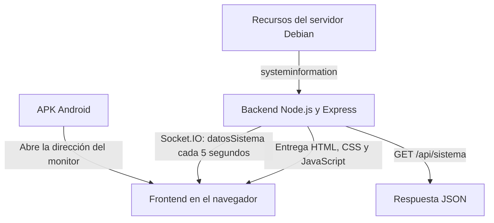

# Monitor de recursos GNU/Linux

**Trabajo Final Integrador – Práctica Profesionalizante III**

Desarrollamos un monitor para consultar los recursos de un servidor GNU/Linux (Debian) desde una computadora o un celular. Tomamos como base el material de la materia y adaptamos el diseño para mostrar la información por secciones.

El backend obtiene los datos del servidor y los expone mediante una API HTTP. El frontend los muestra en pantalla y recibe actualizaciones automáticas con Socket.IO.

## ¿Qué muestra el monitor?

- **Procesador:** fabricante, modelo, núcleos y temperatura, cuando está disponible.
- **Memoria RAM:** total, disponible y utilizada.
- **Almacenamiento:** espacio de la partición raíz y memoria swap.
- **Red:** interfaces, direcciones IP y MAC, datos recibidos y enviados.
- **Vista general:** resumen de los recursos y navegación por secciones.

La información se actualiza cada **5 segundos**, sin necesidad de recargar la página.

## Tecnologías utilizadas

| Parte del proyecto | Tecnologías | Uso |
| --- | --- | --- |
| Frontend | HTML, CSS, JavaScript, Bootstrap 5, Bootstrap Icons | Estructura, diseño y actualización del panel. |
| Backend | Node.js, Express, HTTP, CORS, systeminformation | Servidor web, API y lectura de recursos de Debian. |
| Comunicación | Socket.IO | Envío periódico de datos del backend al frontend. |
| Dependencias | pnpm | Instalación y administración de paquetes. |
| Inicio automático | systemd | Ejecución del backend al iniciar Debian. |
| Aplicación Android | HTML2Apk | Empaquetado de una pantalla de conexión para abrir el monitor desde el celular. |
| Control de versiones | Git y GitHub | Ramas, commits e integración del trabajo. |
| Organización y documentación | GitHub Projects, Markdown, Mermaid, GitHub1s y GitDiagram | Seguimiento de tareas, documentación y análisis del repositorio. |

Durante el desarrollo también utilizamos inteligencia artificial como apoyo para consultas, explicaciones y revisión de código. Las pruebas del funcionamiento se realizaron en nuestro entorno.

## Estructura del repositorio

```text
PPIII-Monitoreo/
├── README.md
├── Monitor_de_Sistema-v1.0-signed.apk
├── docs/
│   ├── github-helpers.md
│   └── evidencias/
│       ├── github1s-monitor.png
│       └── gitdiagram-monitor.png
└── monitor-sistema/
    ├── .gitignore
    ├── backend/
    │   ├── package.json
    │   ├── pnpm-lock.yaml
    │   └── server.js
    ├── deploy/
    │   └── monitor-sistema.service
    └── frontend/
        └── public/
            ├── index.html
            ├── index.js
            └── style.css
```

El archivo `.gitignore` evita incorporar `node_modules` al repositorio. Las dependencias se instalan con pnpm.

## ¿Cómo funciona?

El backend utiliza **systeminformation** para consultar los recursos de Debian. **Express** entrega los archivos del frontend y publica la ruta `/api/sistema`, que devuelve los datos en formato JSON. **Socket.IO** envía actualizaciones a los clientes conectados cada cinco segundos.



El frontend utiliza `const socket = io();` para conectarse al mismo servidor desde el que se abrió la página. Por eso no es necesario escribir una IP fija dentro de `index.js`.

## Instalación y ejecución manual

Se necesita un servidor GNU/Linux con **Node.js 24** y **pnpm**, además de conexión de red entre el servidor y el equipo cliente.

Desde la raíz del repositorio:

```bash
cd monitor-sistema/backend
pnpm install
pnpm start
```

Abrir el panel desde un navegador:

```text
http://IP_DEL_SERVIDOR:3000/
```

Consultar la API:

```text
http://IP_DEL_SERVIDOR:3000/api/sistema
```

Para conocer la dirección IP de Debian:

```bash
ip -4 -br address
```

Reemplazar `IP_DEL_SERVIDOR` por la dirección actual de la máquina Debian. Para detener la ejecución manual, utilizar `Ctrl + C`. Si el servicio systemd ya está funcionando, no iniciar otra instancia del backend en el mismo puerto.

El navegador necesita acceso a Internet para cargar Bootstrap, Bootstrap Icons y el cliente de Socket.IO desde sus respectivos CDN.

## Inicio automático en Debian

En la instalación utilizada, el proyecto se encuentra en:

```text
/var/www/html/monitor-sistema/
```

El archivo `monitor-sistema/deploy/monitor-sistema.service` contiene la configuración del servicio. Con el proyecto y las dependencias instalados en Debian, ejecutar como administrador:

```bash
cp /var/www/html/monitor-sistema/deploy/monitor-sistema.service /etc/systemd/system/
systemctl daemon-reload
systemctl enable --now monitor-sistema
```

Para comprobar su estado:

```bash
systemctl status monitor-sistema --no-pager -l
systemctl is-enabled monitor-sistema
systemctl is-active monitor-sistema
```

Si se modifica el backend y se actualizan sus archivos en Debian:

```bash
systemctl restart monitor-sistema
```

Subir cambios a GitHub **no actualiza automáticamente** la instalación que está ejecutándose en Debian.

## Aplicación Android

El repositorio incluye `Monitor_de_Sistema-v1.0-signed.apk`, creada con **HTML2Apk**.

La aplicación muestra una pantalla para ingresar la IP actual del servidor Debian y abrir el monitor mediante HTTP en el puerto `3000`. De esta manera, no depende de una IP escrita de forma permanente en la APK.

Para utilizarla, el teléfono debe tener acceso por red al servidor y el backend debe estar funcionando. La aplicación abre el monitor servido por Express; **no contiene una copia independiente del backend**.

La APK fue probada y funcionó en un teléfono Android. También comprobamos el acceso al panel desde el navegador de un celular. La compatibilidad de la APK puede variar según el dispositivo y su componente WebView.

## Git, GitHub y trabajo en equipo

Trabajamos con las ramas `mateo1` y `mateo2`, y utilizamos `main` para integrar los avances mediante merge. Los cambios se registraron con commits y se publicaron en GitHub.

Organizamos el seguimiento en el [tablero Kanban de GitHub Projects](https://github.com/users/casemmateo/projects/1). Las seis tareas del proyecto quedaron ubicadas en **Hecho (Done)**.

El tablero es privado. Para que el docente pueda verlo será necesario otorgarle acceso o ajustar su visibilidad.

### GitHub Helpers

Utilizamos **GitHub1s** para consultar el repositorio desde el navegador y **GitDiagram** para generar un diagrama de sus componentes.

La explicación y las capturas están en [docs/github-helpers.md](docs/github-helpers.md).

## Adaptaciones y pruebas

Partimos de los ejemplos del profesor y realizamos estas adaptaciones:

- Separamos backend y frontend en carpetas.
- Publicamos el frontend desde Express.
- Incorporamos un menú por secciones, tarjetas y Bootstrap Icons.
- Utilizamos `io()` para no fijar la dirección IP en el JavaScript del navegador.
- Corregimos las unidades de memoria y almacenamiento a GiB/MiB, la información de espacio disponible y la representación de swap.
- Configuramos el inicio automático del servidor mediante systemd.

Comprobamos la consulta de la API, la navegación del panel, las actualizaciones mediante Socket.IO, los datos mostrados en Debian y el inicio del servicio después de reiniciar la máquina virtual. También probamos el acceso desde dispositivos móviles.

## Limitaciones conocidas

- La temperatura puede aparecer como `N/D` cuando el sistema no permite consultarla.
- Los valores de tráfico de red son acumulados, no velocidades instantáneas.
- Las claves `sda1` y `sda5` del JSON se conservaron del ejemplo original; no necesariamente representan los nombres reales de los dispositivos.
- Se muestra información del procesador, pero no su porcentaje de utilización.
- La aplicación utiliza HTTP y no incorpora autenticación.

## Enlaces del proyecto

- [Repositorio GitHub](https://github.com/casemmateo/TP-FINAL-INTEGRADOR)
- [Tablero Kanban](https://github.com/users/casemmateo/projects/1)
- [Vista en GitHub1s](https://github1s.com/casemmateo/TP-FINAL-INTEGRADOR/tree/main)
- [Vista en GitDiagram](https://gitdiagram.com/casemmateo/TP-FINAL-INTEGRADOR)
