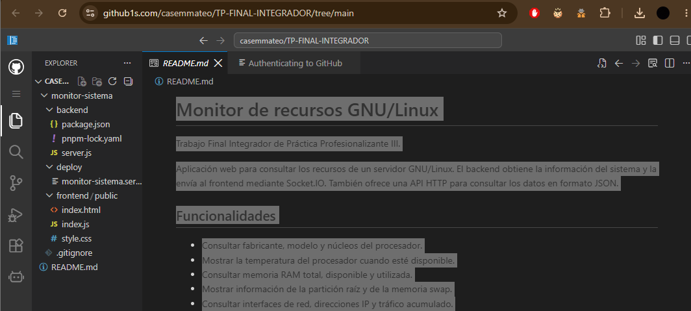
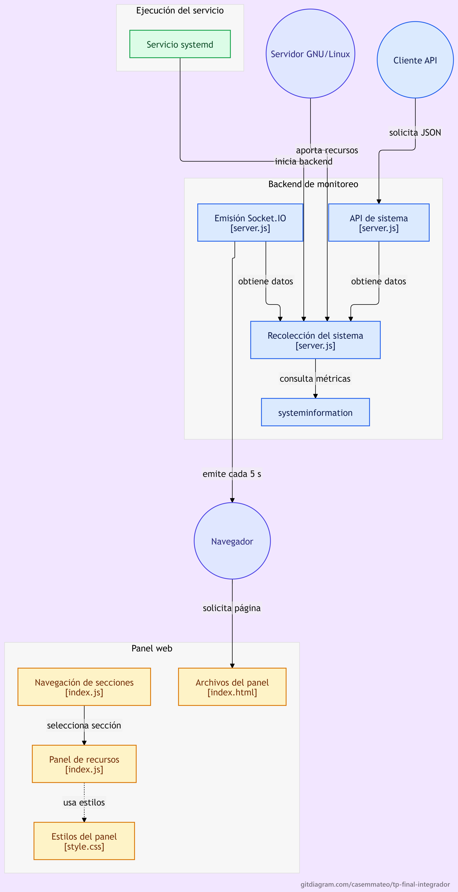

# Uso de GitHub Helpers

Se utilizaron dos herramientas web incluidas en el material de la
clase del 8 de septiembre de 2026 para consultar y analizar el repositorio.

## GitHub1s

Se exploró la rama main desde el navegador y se consultaron el README
y el archivo backend/server.js.

Esto permitió revisar la estructura del proyecto y comprobar que
estaban disponibles las correcciones de unidades, espacio disponible
y swap.

[Consultar el repositorio en GitHub1s](https://github1s.com/casemmateo/TP-FINAL-INTEGRADOR/tree/main)

## GitDiagram

Se generó y exportó un diagrama del repositorio para visualizar sus
componentes principales: servicio systemd, backend, API HTTP,
Socket.IO, systeminformation y frontend.

[Consultar el repositorio en GitDiagram](https://gitdiagram.com/casemmateo/TP-FINAL-INTEGRADOR)

### Revisión del resultado

El diagrama identifica los componentes principales, pero presenta
etiquetas superpuestas y no muestra claramente que Express entrega
los archivos HTML, CSS y JavaScript al navegador.

Se conserva como evidencia del análisis automático. El diagrama
Mermaid del README se mantiene como explicación revisada del
funcionamiento de la aplicación.

